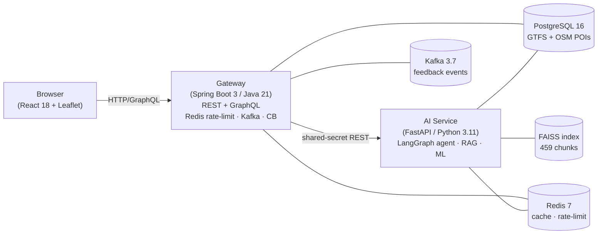

# CommuteIQ

Bengaluru hybrid-work commute copilot for the Outer Ring Road / Whitefield / Electronic City
corridor. Combines multimodal GTFS routing, ML runtime prediction, policy-grounded RAG, and a
LangGraph agent — built as a portfolio project for MoveInSync's AI/ML Engineer internship.

## Architecture



## Component Status

| Component | Status | Verified by |
|---|---|---|
| AI service — FastAPI + router + ML + RAG + agent | **Verified** | `pytest`: 17 passed, 1 skipped |
| Gateway — Spring Boot 3 REST + GraphQL + Redis + Kafka | **Verified** | `mvnw verify` exit 0 |
| Docker Compose stack definition | **Written, not end-to-end tested** | compose.yml present; no live `docker compose up` run captured |
| Web — React 18 + Vite 4 + TypeScript + Leaflet | **Written, not verified** | `web/` untracked; `npm run build` not confirmed |
| Kubernetes manifests | **Written, not cluster-tested** | `kubectl apply --dry-run` not run (kubectl availability unknown) |
| CI workflow | **Written, not run** | `.github/workflows/ci.yml` not triggered |

## Skills Demonstrated

| JD Skill | Evidence file |
|---|---|
| LangGraph (multi-node agent) | [`services/ai/app/agent/graph.py`](services/ai/app/agent/graph.py) |
| LangChain / LlamaIndex (RAG) | [`services/ai/app/rag/`](services/ai/app/rag/) |
| HuggingFace embeddings (`bge-small-en-v1.5`) | [`services/ai/app/rag/embeddings.py`](services/ai/app/rag/embeddings.py) |
| FAISS vector store | [`services/ai/app/rag/vector_store.py`](services/ai/app/rag/vector_store.py) |
| Pinecone adapter | [`services/ai/app/rag/vector_store.py`](services/ai/app/rag/vector_store.py) |
| Weaviate adapter | [`services/ai/app/rag/vector_store.py`](services/ai/app/rag/vector_store.py) |
| OpenAI-compatible SDK (Gemini/Groq) | [`services/ai/app/llm/client.py`](services/ai/app/llm/client.py) |
| Claude adapter | [`services/ai/app/llm/client.py`](services/ai/app/llm/client.py) |
| MLflow / MLOps | [`services/ai/app/ml_model.py`](services/ai/app/ml_model.py) |
| REST API | [`services/gateway/src/main/java/com/commuteiq/gateway/controller/`](services/gateway/src/main/java/com/commuteiq/gateway/controller/) |
| GraphQL | [`services/gateway/src/main/resources/graphql/`](services/gateway/src/main/resources/graphql/) |
| Spring Boot 3 | [`services/gateway/`](services/gateway/) |
| PostgreSQL + Flyway | [`services/gateway/src/main/resources/db/migration/`](services/gateway/src/main/resources/db/migration/) |
| Redis (rate-limit Lua + cache) | [`services/gateway/src/main/java/com/commuteiq/gateway/filter/`](services/gateway/src/main/java/com/commuteiq/gateway/filter/) |
| Kafka producers + consumer | [`services/gateway/`](services/gateway/) · [`services/ai/app/consumer.py`](services/ai/app/consumer.py) |
| Resilience4j circuit breaker | [`services/gateway/src/main/resources/application.yml`](services/gateway/src/main/resources/application.yml) |
| Docker / Compose | [`deploy/compose.yml`](deploy/compose.yml) |
| Kubernetes / Kustomize | [`deploy/k8s/`](deploy/k8s/) |
| Security (shared secret, injection neutralization) | [`services/ai/app/rag/context_builder.py`](services/ai/app/rag/context_builder.py) |
| Testing (pytest, JUnit, Mockito) | [`services/ai/tests/`](services/ai/tests/) · [`services/gateway/src/test/`](services/gateway/src/test/) |

## Real Data Corpus

All data is real; no synthetic or mocked data anywhere in the project.

| Dataset | Rows / count | Licence |
|---|---|---|
| BMTC GTFS (stops, routes, trips, stop_times) | 4,433 stops · 4,271 routes · 15,170 trips · 15,017 stop_times | Open Transit Data / DULT Karnataka |
| BMRCL Namma Metro GTFS | 488 stops · 3 routes · 3,279 trips · 88,906 stop_times | CC-BY-4.0 |
| OSM tech park POIs (Bengaluru) | 284 offices | ODbL 1.0 © OpenStreetMap contributors |
| Policy / RAG corpus | 18 documents (10 VERIFIED + 8 UNVERIFIED), 459 indexed chunks | Public government + news sources (see `docs/DATA.md`) |

**Database totals** (loaded via Docker Postgres 16, `data/scripts/load_gtfs.py`):
`stop` 4,921 · `route` 4,274 · `trip` 18,449 · `stop_time` 103,923 · `office` 284

## Quickstart

```bash
# Prerequisites: Java 21, Python 3.11, Docker, make

# 1. Fetch real GTFS + OSM + policy corpus (needs network)
make fetch-data

# 2. Regenerate FAISS index + ML model (needs Postgres running)
make up          # start infra only: docker compose ... postgres redis kafka
make load-db     # GTFS + OSM → Postgres
make train-ml    # GBR regressor → MLflow; also builds FAISS index

# 3. Run tests
make test-ai     # pytest (17 passed, 1 skipped; verified)
make test-gateway  # mvnw verify (exit 0; verified)

# 4. Start full stack
make up
# AI service:  http://localhost:8001/docs
# Gateway:     http://localhost:8080/swagger-ui.html  or  /graphiql
# Web:         http://localhost:3001
```

> **Ignored artifacts** that must be regenerated locally: `data/raw/` (GTFS zips + policy PDFs),
> `services/ai/faiss_index/`, `services/ai/mlruns/`, `services/ai/mlflow.db`, `web/dist/`.

## Limitations

- **Scheduled times only**: ETAs come from static GTFS timetables + GBR regression; no live GPS.
- **Partial BMTC coverage**: Feed covers arterial routes; some feeder corridors are absent.
- **Free-tier LLM quotas**: Gemini 20 req/day; Groq fallback + on-disk response cache prevents
  quota exhaustion during evaluation. Full LLM answers require a paid API key or local model.
- **No live deployment**: All services run locally via Docker Compose; no cloud environment exists.
- **Web unverified**: React frontend code is written but `npm run build` has not been confirmed
  in CI; treat as work-in-progress.

## Cloud Design Note

See [`docs/CLOUD.md`](docs/CLOUD.md) for a component-by-component AWS/GCP/Azure mapping.
This is a design exercise; nothing is deployed to a cloud provider.

---

*Built with AI assistance (Antigravity; Gemini and Claude models); design, review and
verification by me.*
